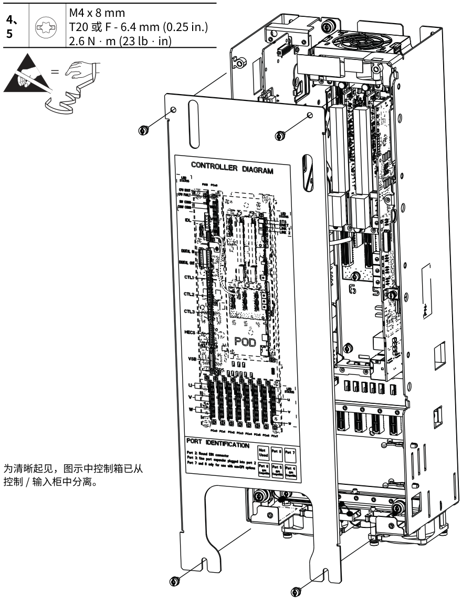
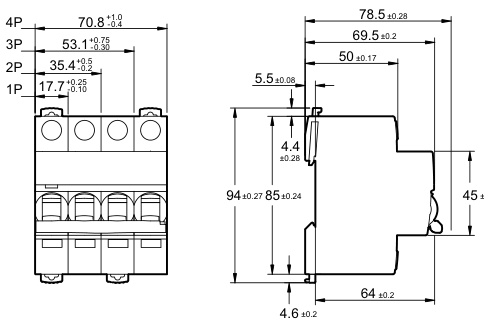
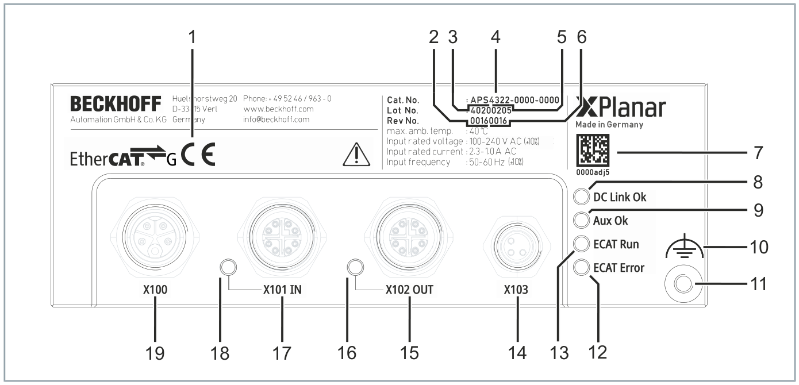
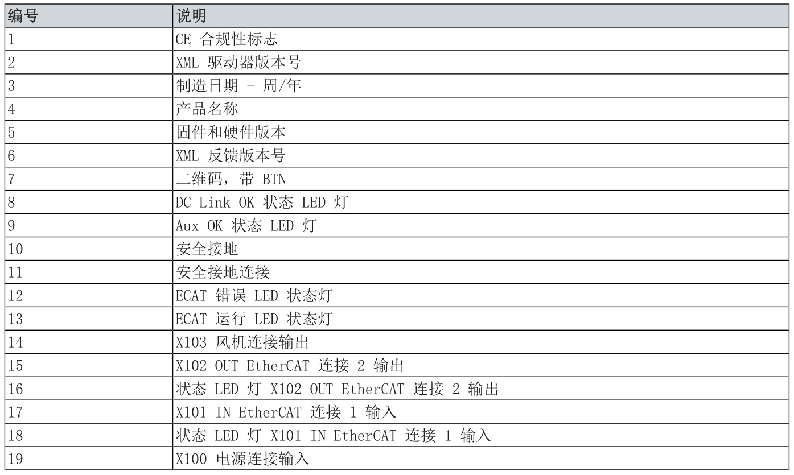

# NativePDF Structurer

**简体中文** | [English](README_EN.md)

一个面向大体量数字原生 PDF 的、零 OCR、零模型依赖的文档结构化工具。

项目主要服务于厂商发布的技术文档，例如设备操作手册、维修手册、安装说明、
产品选型手册、电气手册和技术目录。这类 PDF 往往包含数十至数百页内容，并
反复出现页眉页尾、参数表、步骤编号、设备插图、矢量标注和图文混排区域；
NativePDF Structurer 的处理策略主要围绕这些结构设计。

学术论文可以作为普通数字原生 PDF 处理，但不是当前版本的主要优化场景。
项目不把复杂公式准确还原为 LaTeX 作为目标。默认公式以页面渲染图保留；可选的
LaTeX 通道只依据原生文字层，对结构明确的简单公式进行保守尝试，结果不保证可靠，
不能替代专业公式识别工具。项目也没有针对论文中的引用关系、双栏论文模板和语义
章节分类进行专项建模。对于页数较少的论文，尤其需要公式恢复、OCR、图表理解或
图片语义识别时，更推荐直接使用
[MinerU](https://github.com/opendatalab/MinerU) 等具备模型或 VLM 解析路径的
成熟工具。

## 项目定位

项目关注“长文档能否稳定进入 RAG 流程”，不局限于追求单页 PDF 到 Markdown
的表面转换。典型输入通常具备以下特征：

- 文档页数较多，需要保持跨页章节、页名和来源定位；
- 页面模板重复，需要识别并排除页眉、页尾中的装饰图元；
- 正文中混合原生图片、矢量图、引线、编号标签和说明文字；
- 同一页同时存在参数表、设备图和操作步骤，需要重建阅读顺序；
- 输出需要同时支持人工阅读、RAG 分块和问题回溯。

本项目的设计目标，是在不依赖图片语义识别和 VLM 推理的前提下，针对复杂的
数字原生 PDF 完成尽可能充分的结构还原，并在厂商手册、技术目录等目标场景中，
使最终输出的可用性接近 MinerU 这类完整文档解析工具。这里描述的是项目方向，
不是已经完成统一数据集精度对标的结论；两类工具依赖条件和优势场景并不相同。

项目不使用 OCR 或视觉语言模型补猜页面语义，而是利用 PDF 已有的文字层、
字体、坐标、图片对象和矢量路径建立可审计的结构化结果。因此，它最适合文字层
和绘图对象保存完整的数字原生厂商 PDF。

NativePDF Structurer 可以独立使用，也可以作为后续 RAG 或多模态流水线的结构化
输入层。不要求理解图片语义时，项目输出的 Markdown、图片、表格及可选 IR
本身就可以作为最终产物。项目可以识别图片、矢量图、表格及其空间关系，并保留
图内原生文字，但不会判断设备图片表达的语义，也不会生成图片描述、故障解释或
操作含义。

如果后续任务需要理解图片内容，可以将视觉区域 PNG、表格、Markdown、IR 和
provenance 继续交给 VLM 处理。这样先由确定性的 PDF 图元分析完成切分、排序和
来源定位，再只对确有需要的视觉区域调用模型。

项目除输出 Markdown 外，还包括：

- 适合阅读和分块检索的 Markdown；
- Markdown 引用的图片、表格 CSV 和公式渲染图；
- 可选的结构化中间表示（IR）；
- 可追踪的图元、Claim、页面和输出来源信息（provenance）。

两种使用方式：

```text
数字原生 PDF
    -> NativePDF Structurer（结构恢复、资源切分、阅读顺序、来源定位）
    -> Markdown + 图片/表格 + IR + provenance
        ├─ 直接作为最终文档或 RAG 输入（不需要图片释义）
        └─ 可选 VLM（图片语义描述、图表理解或多模态索引）
             -> 语义增强后的 RAG 入库与检索
```

项目使用 PyMuPDF 的原生文字、字体、图片、矢量路径和坐标信息，重建页面的
阅读顺序、章节层级、表格和视觉区域。项目不依赖 OCR、GPU、Poppler、
Ghostscript 或外部文档服务。

项目的模块边界、页面阶段契约、Claim 所有权模型和扩展流程见
[`docs/architecture.md`](docs/architecture.md)。

## 主要特点

- 页面级 `PageRunContext`：隔离单页可变状态和文档级配置；
- 稳定图元 ID：支持表格、图片、矢量区域和文字的来源追踪；
- 表格检测：结合原生表格检测、规则线几何补检和复杂表格截图；
- 视觉区域处理：支持矢量簇、原始图片、连接线、图内文字和双 bbox；
- 阅读顺序重建：支持旋转文字、多栏、窄编号列和二级空间切分；
- 最简模式：默认只输出 Markdown 和其引用资源；
- 调试模式：额外输出 IR、JSON、审计报告和阅读顺序调试图。

## 转换结果示例

以下图片直接取自三份厂商 PDF 的前 60 页回归结果，未经过 OCR 或模型二次
修复。README 只保留少量转换产物，用于说明输出形态；相关原始内容、图形和
商标归对应权利人所有。

### 复杂设备图和附着信息

维修手册中的设备图可能同时包含位图、矢量轮廓、引线、警告符号、小型参数框
和图内文字。项目将彼此连接的对象保留为一个视觉区域，避免在 Markdown 中被
拆成顺序错乱的多张小图。

<p align="center">
  
</p>

### 表格与尺寸图分离

产品选型手册中，规则表格和相邻的尺寸矢量图会分别进入表格通道与视觉区域
通道。表格可以同时输出用于阅读的 PNG 和用于后续处理的 CSV，尺寸图则保留
原始版面关系。

<table>
  <tr>
    <td width="56%" align="center">
      
    </td>
    <td width="44%" align="center">
      
    </td>
  </tr>
  <tr>
    <td align="center">参数表：PNG + CSV</td>
    <td align="center">尺寸图：视觉区域 PNG</td>
  </tr>
</table>

### 编号图与说明表保持关联

操作手册常用编号引线解释设备接口，再由下一张表逐项说明编号含义。项目会
保留编号图的整体几何关系，并让说明表紧随其后输出，便于阅读和后续 RAG 分块。

<p align="center">
  
</p>

<p align="center">
  
</p>

对于这类内容，Markdown 通常保留视觉结果、原生图内文字和表格数据入口：

```markdown


> **图内文字（PDF原生文本）**
> X100
> X101 IN

### Table 1 (20 × 2)

[CSV data](tables/page_017_table_01_rotated_+0.csv)
```

## 安装

### 环境要求

- Python 3.12 或更高版本；
- 当前验证环境为 Python 3.12.13。

| 组件 | 验证版本 | 用途 |
|---|---:|---|
| PyMuPDF | 1.28.0 | PDF 文字、图片、绘图、表格和渲染 |
| NumPy | 2.5.1 | 掩码和几何数组 |
| OpenCV headless | 5.0.0.93 | 形态学处理和连通域 |
| Pillow | 12.3.0 | 图片输出和调试覆盖层 |

> [!CAUTION]
> OpenCV 只应安装 `opencv-python-headless`。不要同时安装其他提供 `cv2` 模块的
> OpenCV 发行包，否则可能发生模块覆盖或二进制依赖冲突。

下载或克隆源码后，进入项目根目录：

```bash
cd nativePDF-structurer
```

### Conda 安装（推荐）

```bash
conda env create -f environment.yml
conda activate nativePDF-structurer
python -m nativePDF_structurer --help
```

### pip 安装

建议在新的虚拟环境中安装：

```bash
python -m venv .venv
source .venv/bin/activate          # macOS / Linux
# .venv\Scripts\Activate.ps1      # Windows PowerShell

python -m pip install .
nativePDF-structurer --help
```

参与开发时使用 editable install，并复现项目验证过的依赖版本：

```bash
python -m pip install -r requirements.txt
python -m pip install -e . --no-deps
```

### 验证安装

```bash
python -c "import nativePDF_structurer; print(nativePDF_structurer.__version__)"
python -m nativePDF_structurer --help
nativePDF-structurer --help
```

以上命令应输出版本号 `0.1.0`，并通过模块入口和命令行入口显示帮助信息。

### 运行测试

```bash
python -m unittest discover -s tests -v
```

PyMuPDF 具有独立的 AGPL / 商业授权条款。重新分发包含本项目的应用前，请单独
确认 PyMuPDF 和项目内第三方组件的许可证要求。

## 最小运行

```bash
python -m nativePDF_structurer input.pdf -o output/
```

默认只生成主 Markdown 及其引用的图片和 CSV。页码使用从 1 开始的编号：

```bash
python -m nativePDF_structurer input.pdf \
  -o output-debug/ \
  --pages 1-60 \
  --debug-output
```

常用选项：

```text
--pages SPEC                         选择页码，例如 1-20,24,28
--debug-output                       输出 IR、JSON、报告和调试图
--heading-detection / --no-heading-detection
--font-heading-inference / --no-font-heading-inference
--table-header-detection / --no-table-header-detection
--keep-header-text / --no-keep-header-text
--formula-detection / --no-formula-detection
--formula-output MODE                  公式输出：image（默认）、latex 或 hybrid
--pdf-outline-heading-assignment / --no-pdf-outline-heading-assignment
--force-pure-text-table-to-markdown / --no-force-pure-text-table-to-markdown
```

公式默认渲染为 PNG，以避免复杂上下标、分式和混合字体公式被错误改写。
使用 `--formula-output latex` 或 `--formula-output hybrid` 时，程序只对
能够由原生文字层明确线性化的简单公式尝试输出 Markdown 数学块；复杂或有歧义的
公式自动回退为 PNG，因此该通道不承诺数学语义和排版完全正确。生成的 `$$ ... $$`
需要由下游 Markdown 阅读器提供 MathJax 或 KaTeX 渲染，项目本身不额外引入
LaTeX 编译器或 Python 数学包。

## 输出结构

最简模式通常包含：

```text
output/
├── document_with_reflowed_text_and_tables.md
├── source_images/
├── visual_regions/
├── tables/
└── formula_images/       # 开启公式处理时创建
```

调试模式额外包含：

- `document_ir.json`；
- 页面、表格、图片、视觉区域和 Claim JSON；
- 页眉页尾、标题、图题、规则线和冲突报告；
- 阅读顺序调试图和页面契约记录。

## Python API

```python
from pathlib import Path

from nativePDF_structurer import RunConfig, run

config = RunConfig(
    source_pdf=Path("input.pdf"),
    output_dir=Path("output"),
    pages=(1, 2, 3),
    debug_output=False,
)
result = run(config)
print(result.summary)
```

## 适用范围和限制

适合数字原生 PDF：PDF 中需要存在可读取的文字层、图片对象或矢量路径。

不保证直接解决以下情况：

- 纯扫描 PDF 或损坏的文字层；
- 依赖 OCR 才能恢复的文字；
- 需要模型理解图片中设备、动作、故障或业务语义的任务；
- 极度依赖语义模型才能判断的复杂版面关系；
- 原生表格检测已经丢失边界信息的情况。

## 输出回归校验

项目提供通用的输出 manifest 工具，用于比较文件路径、大小和 SHA-256：

```bash
python -m nativePDF_structurer.regression_manifest create \
  output manifest.json

python -m nativePDF_structurer.regression_manifest verify \
  output manifest.json
```

## 许可证

除明确注明的第三方内容外，本项目原创代码采用
[Apache License 2.0](LICENSE) 授权。该许可证允许使用、修改和再分发，并提供
明确的专利授权条款。

许可证边界需要特别注意：

- 内置的 GapTree 实现仍遵循原作者的 MIT License；
- PyMuPDF 是 AGPL-3.0 / Artifex 商业许可双授权的外部运行时依赖；
- `docs/assets/examples/` 中的厂商文档示例图片不属于 Apache-2.0 再授权范围。

完整说明见 [THIRD_PARTY_NOTICES.md](THIRD_PARTY_NOTICES.md)。本项目采用
Apache-2.0 不代表 PyMuPDF 或其他第三方组件的许可证义务被解除。

## 致谢

本项目的阅读顺序处理受
[GapTree Sort Algorithm](https://github.com/hiroi-sora/GapTree_Sort_Algorithm)
启发，并以 hiroi-sora 开源的 GapTree 实现为基础，结合本项目对 PDF 文字、
表格、图片和矢量区域的统一排序需求进行了扩展。感谢作者公开这一清晰而实用的
版面排序思路与实现。第三方代码的 MIT 许可证保留在
[`nativePDF_structurer/_vendor/GapTree_LICENSE.txt`](nativePDF_structurer/_vendor/GapTree_LICENSE.txt)。
