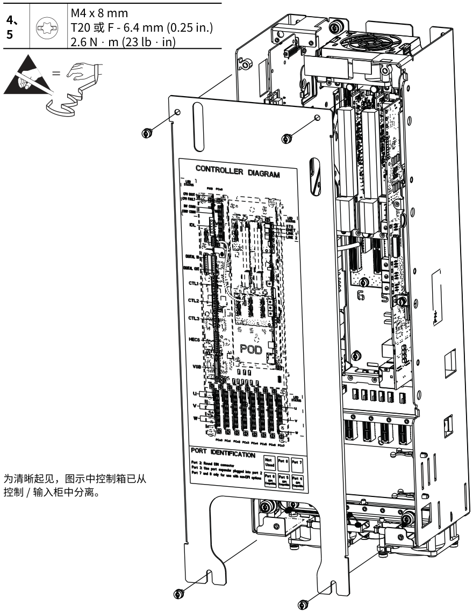
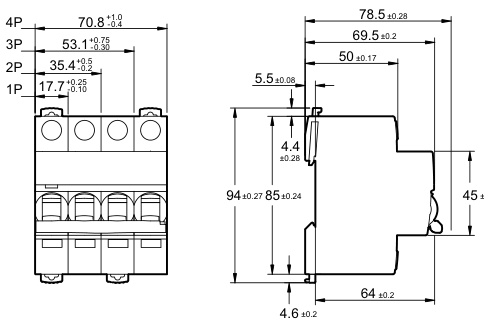
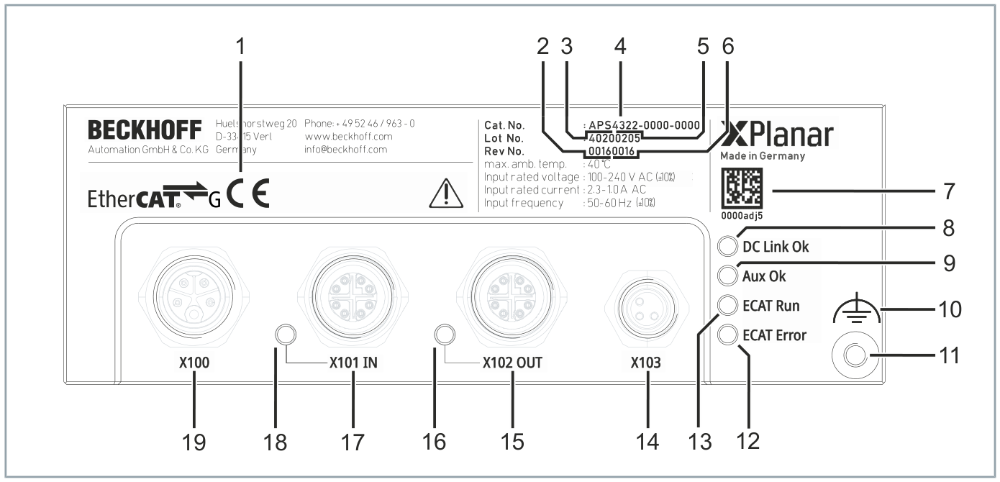
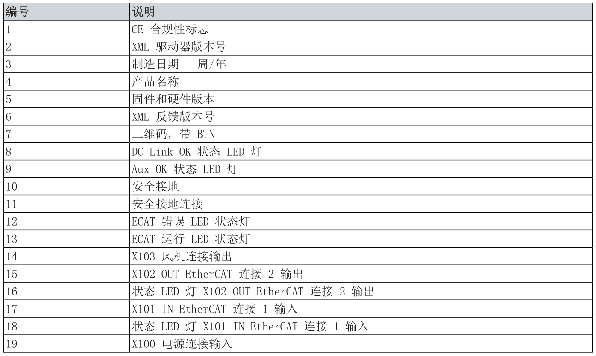

# NativePDF Structurer

[简体中文](README.md) | **English**

A zero-OCR, zero-model document structuring tool for large digital-native PDF
documents.

The project is primarily designed for technical documents published by
manufacturers, including equipment operation manuals, service manuals,
installation instructions, product selection guides, electrical manuals, and
technical catalogs. These PDFs often contain tens or hundreds of pages with
repeated headers and footers, parameter tables, numbered procedures, equipment
illustrations, vector annotations, and mixed text-and-graphic regions.
NativePDF Structurer is optimized around those structures.

Academic papers can be processed as ordinary digital-native PDFs, but they are
not the primary target of the current release. The project does not treat exact
reconstruction of complex equations as a goal. Equations are kept as rendered
page images by default; the optional LaTeX path makes a conservative attempt
only for simple expressions that are clearly linearized by the native text
layer, and its result is not guaranteed to be reliable or mathematically
equivalent. The project also does not include specialized models for citation
relationships, two-column paper templates, or semantic section classification.
For shorter papers, especially when equation recovery, OCR, chart understanding,
or image semantics are required, a mature tool with
model- or VLM-based parsing paths such as
[MinerU](https://github.com/opendatalab/MinerU) is generally a better choice.

## Project focus

The project is concerned with whether a long document can enter a RAG pipeline
reliably, rather than only producing a visually plausible single-page Markdown
conversion. Typical inputs have the following characteristics:

- many pages whose section hierarchy, page names, and source locations must be
  retained;
- repeated page templates whose decorative header and footer drawings must be
  excluded;
- native images, vector drawings, connector lines, numbered labels, and
  explanatory text mixed in the same content area;
- parameter tables, equipment diagrams, and procedural steps on the same page,
  requiring reconstructed reading order;
- outputs that must support human reading, RAG chunking, and source tracing.

The design goal is to recover as much structure as possible from complex
digital-native PDFs without image-semantic recognition or VLM inference. In
the target domain of manufacturer manuals and technical catalogs, the project
aims for output usability approaching that of full document-parsing systems
such as MinerU. This is a project direction, not a claim of benchmarked parity
on a shared evaluation dataset; the dependency profiles and strongest use cases
of the two approaches are different.

The project does not use OCR or a vision-language model to guess page semantics.
It builds an auditable structure from the PDF's existing text layer, fonts,
coordinates, image objects, and vector paths. It is therefore best suited to
digital-native manufacturer PDFs whose text and drawing objects are intact.

NativePDF Structurer can be used independently or as the structured input layer
for a downstream RAG or multimodal pipeline. When image semantics are not
required, its Markdown, images, tables, and optional IR can be treated as the
final deliverables. The project identifies images, vector drawings, tables, and
their spatial relations, and preserves native text found inside figures. It
does not infer what an equipment image means or generate image descriptions,
fault explanations, or operational semantics.

When a downstream task needs image understanding, pass the visual-region PNG
files, tables, Markdown, IR, and provenance to a VLM. Deterministic PDF
segmentation, ordering, and source tracing are then completed before model-based
semantic enrichment is applied only where it is useful.

The output is more than Markdown. It can include:

- Markdown suitable for reading and retrieval chunking;
- referenced images, table CSV files, and rendered equation images;
- an optional structured intermediate representation (IR);
- traceable element, Claim, page, and output provenance.

Two usage paths:

```text
Digital-native PDF
    -> NativePDF Structurer (structure, assets, reading order, provenance)
    -> Markdown + images/tables + IR + provenance
        |- Final document or RAG input when image semantics are not required
        `- Optional VLM (descriptions, chart understanding, multimodal index)
             -> Semantically enriched RAG ingestion and retrieval
```

The project uses PyMuPDF's native text, font, image, vector-path, and coordinate
information to reconstruct reading order, heading hierarchy, tables, and visual
regions. It does not require OCR, a GPU, Poppler, Ghostscript, or an external
document service.

For module boundaries, page-stage contracts, the Claim ownership model, and the
extension workflow, see
[`docs/architecture_EN.md`](docs/architecture_EN.md).

## Highlights

- Page-level `PageRunContext` isolates mutable page state from document-level
  configuration.
- Stable element IDs support provenance for tables, images, vector regions, and
  text.
- Table detection combines native table detection, geometry fallback based on
  rule lines, and screenshot output for complex tables.
- Visual-region processing supports vector clusters, source images, connector
  lines, native text inside figures, and separate render/sort bounding boxes.
- Reading-order reconstruction supports rotated text, multiple columns, narrow
  numbering columns, and a second spatial partitioning stage.
- Minimal mode writes only Markdown and referenced assets by default.
- Debug mode additionally writes IR, JSON, audit reports, and reading-order
  overlays.

## Output examples

The following images come directly from the first 60 pages of three manufacturer
PDF regression runs. No OCR or model-based repair was applied. The repository
keeps only a few converted assets to demonstrate the output form. The original
content, graphics, and trademarks remain the property of their respective
owners.

### Complex equipment diagrams and attached information

A service-manual diagram may combine raster images, vector outlines, connector
lines, warning symbols, small parameter boxes, and native text. Connected
objects are retained as a single visual region so they are not split into
several out-of-order fragments in Markdown.

<p align="center">
  
</p>

### Separating tables from dimension drawings

In a product selection manual, a regular table and an adjacent vector dimension
drawing are routed to the table and visual-region channels independently. The
table can provide a PNG for reading and a CSV for downstream processing, while
the dimension drawing preserves its original spatial relationships.

<table>
  <tr>
    <td width="56%" align="center">
      
    </td>
    <td width="44%" align="center">
      
    </td>
  </tr>
  <tr>
    <td align="center">Parameter table: PNG + CSV</td>
    <td align="center">Dimension drawing: visual-region PNG</td>
  </tr>
</table>

### Keeping a numbered diagram next to its explanation table

Operation manuals often explain equipment interfaces with numbered callouts and
then define the numbers in a following table. The project preserves the complete
geometry of the numbered diagram and emits the explanation table immediately
after it, which is useful for reading and RAG chunking.

<p align="center">
  
</p>

<p align="center">
  
</p>

For this type of content, Markdown normally retains the visual result, native
text found inside the figure, and a link to the table data:

```markdown


> **Text inside the figure (native PDF text)**
> X100
> X101 IN

### Table 1 (20 × 2)

[CSV data](tables/page_017_table_01_rotated_+0.csv)
```

## Installation

### Requirements

- Python 3.12 or newer;
- the current validated environment uses Python 3.12.13.

| Component | Validated version | Purpose |
|---|---:|---|
| PyMuPDF | 1.28.0 | PDF text, images, drawings, tables, and rendering |
| NumPy | 2.5.1 | Masks and geometry arrays |
| OpenCV headless | 5.0.0.93 | Morphology and connected components |
| Pillow | 12.3.0 | Image output and debug overlays |

> [!CAUTION]
> Install only `opencv-python-headless`. Do not install another OpenCV
> distribution that provides the same `cv2` module, because the packages may
> overwrite one another or introduce binary dependency conflicts.

After downloading or cloning the source, enter the project root:

```bash
cd nativePDF-structurer
```

### Conda installation (recommended)

```bash
conda env create -f environment.yml
conda activate nativePDF-structurer
python -m nativePDF_structurer --help
```

### pip installation

Installation in a new virtual environment is recommended:

```bash
python -m venv .venv
source .venv/bin/activate          # macOS / Linux
# .venv\Scripts\Activate.ps1      # Windows PowerShell

python -m pip install .
nativePDF-structurer --help
```

For development, use an editable install with the validated dependency set:

```bash
python -m pip install -r requirements.txt
python -m pip install -e . --no-deps
```

### Verify the installation

```bash
python -c "import nativePDF_structurer; print(nativePDF_structurer.__version__)"
python -m nativePDF_structurer --help
nativePDF-structurer --help
```

The commands should print version `0.1.0` and display help through both the
module entry point and the console script.

### Run the tests

```bash
python -m unittest discover -s tests -v
```

PyMuPDF has separate AGPL and commercial licensing terms. Before redistributing
an application that includes this project, review the licensing requirements
of PyMuPDF and the third-party components included in this repository.

## Minimal run

```bash
python -m nativePDF_structurer input.pdf -o output/
```

By default, the command writes the main Markdown document and its referenced
images and CSV files. Page numbers are one-based:

```bash
python -m nativePDF_structurer input.pdf \
  -o output-debug/ \
  --pages 1-60 \
  --debug-output
```

Common options:

```text
--pages SPEC                         Select pages, for example 1-20,24,28
--debug-output                       Write IR, JSON, reports, and debug images
--heading-detection / --no-heading-detection
--font-heading-inference / --no-font-heading-inference
--table-header-detection / --no-table-header-detection
--keep-header-text / --no-keep-header-text
--formula-detection / --no-formula-detection
--formula-output MODE                  Formula output: image (default), latex, or hybrid
--pdf-outline-heading-assignment / --no-pdf-outline-heading-assignment
--force-pure-text-table-to-markdown / --no-force-pure-text-table-to-markdown
```

Formulas are rendered as PNG by default to avoid rewriting complex fractions,
scripts, and mixed-font expressions incorrectly. With
`--formula-output latex` or `--formula-output hybrid`, the parser emits a
Markdown math block only when the native text layer can be clearly linearized;
ambiguous equations fall back to PNG. This path does not guarantee exact
mathematical semantics or typography. Rendering `$$ ... $$` requires MathJax or
KaTeX in the downstream Markdown viewer. No LaTeX compiler or additional Python
math package is required.

## Output layout

Minimal mode normally produces:

```text
output/
├── document_with_reflowed_text_and_tables.md
├── source_images/
├── visual_regions/
├── tables/
└── formula_images/       # Created when equation processing is enabled
```

Debug mode additionally produces:

- `document_ir.json`;
- page, table, image, visual-region, and Claim JSON records;
- header/footer, heading, figure-caption, rule-line, and conflict reports;
- reading-order debug images and page-contract records.

## Python API

```python
from pathlib import Path

from nativePDF_structurer import RunConfig, run

config = RunConfig(
    source_pdf=Path("input.pdf"),
    output_dir=Path("output"),
    pages=(1, 2, 3),
    debug_output=False,
)
result = run(config)
print(result.summary)
```

## Scope and limitations

The input must be a digital-native PDF containing a readable text layer, image
objects, or vector paths.

The project does not guarantee direct recovery of:

- scanned-only PDFs or damaged text layers;
- text that requires OCR;
- tasks that require a model to understand equipment, actions, faults, or other
  semantics shown in images;
- complex layout relationships that depend heavily on semantic models;
- table boundaries already lost by the native table detector.

## Output regression verification

A generic output-manifest tool is included for comparing file paths, sizes, and
SHA-256 hashes:

```bash
python -m nativePDF_structurer.regression_manifest create \
  output manifest.json

python -m nativePDF_structurer.regression_manifest verify \
  output manifest.json
```

## License

Except for third-party content explicitly identified below, the original code
in this project is licensed under the
[Apache License 2.0](LICENSE). The license permits use, modification, and
redistribution and includes an explicit patent grant.

Important license boundaries:

- the bundled GapTree implementation remains under its original MIT License;
- PyMuPDF is an external runtime dependency dual licensed under AGPL-3.0 or an
  Artifex commercial license;
- manufacturer-document examples in `docs/assets/examples/` are not relicensed
  under Apache-2.0.

See [THIRD_PARTY_NOTICES.md](THIRD_PARTY_NOTICES.md) for the complete notice.
Licensing this project under Apache-2.0 does not remove the license obligations
of PyMuPDF or any other third-party component.

## Acknowledgements

The reading-order processing in this project was inspired by the
[GapTree Sort Algorithm](https://github.com/hiroi-sora/GapTree_Sort_Algorithm)
and is based on the open-source GapTree implementation by hiroi-sora. It is
extended here to order native PDF text, tables, images, and vector regions in a
shared document pipeline. Many thanks to the author for publishing this clear
and practical layout-sorting approach and implementation. The MIT license for
the third-party code is retained in
[`nativePDF_structurer/_vendor/GapTree_LICENSE.txt`](nativePDF_structurer/_vendor/GapTree_LICENSE.txt).
